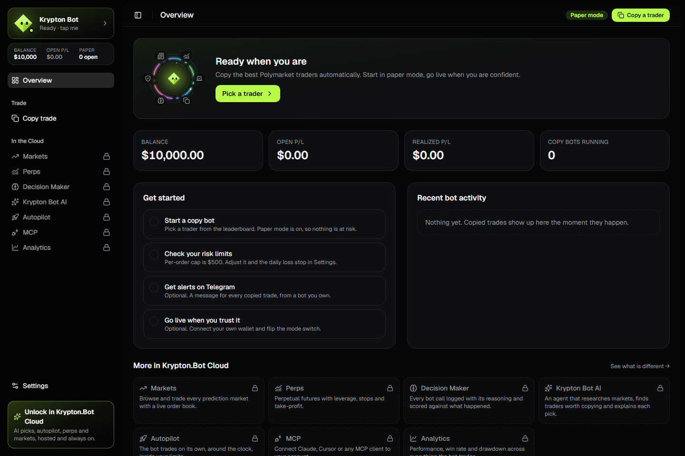
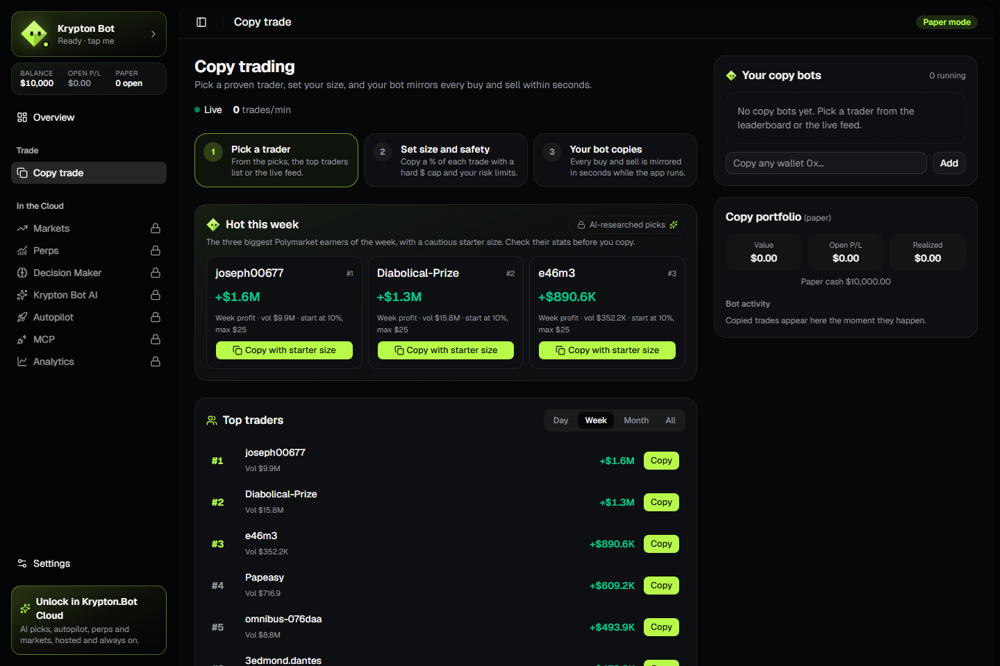
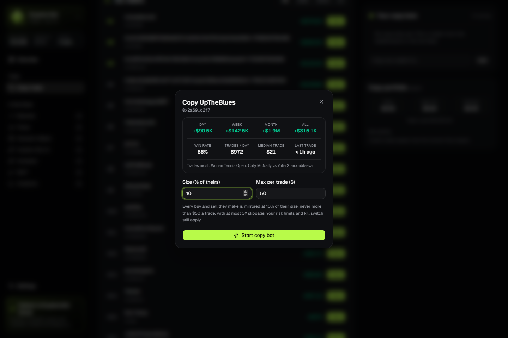
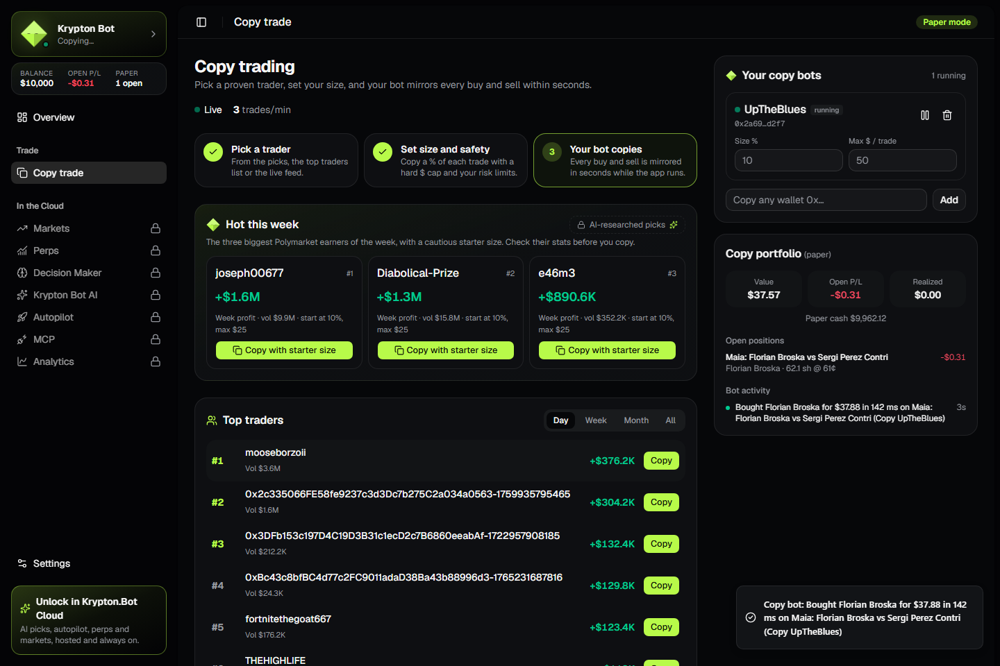
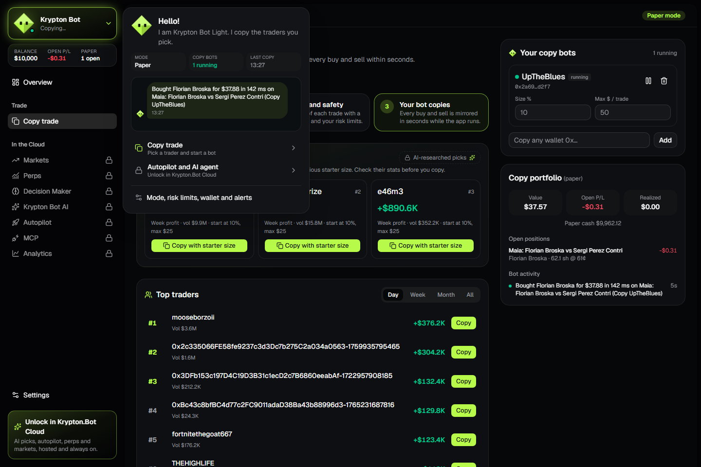
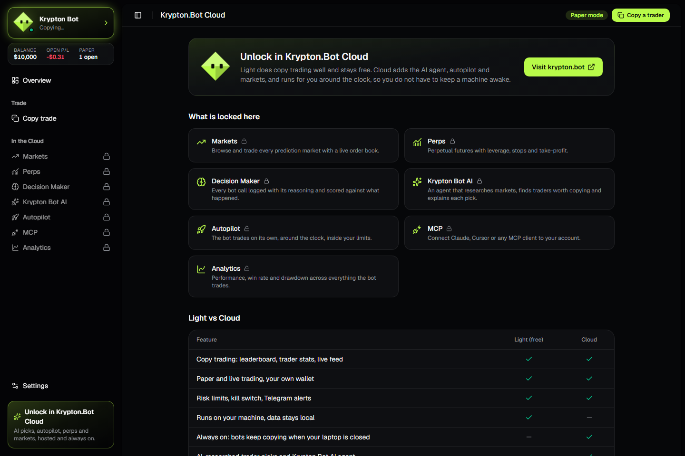
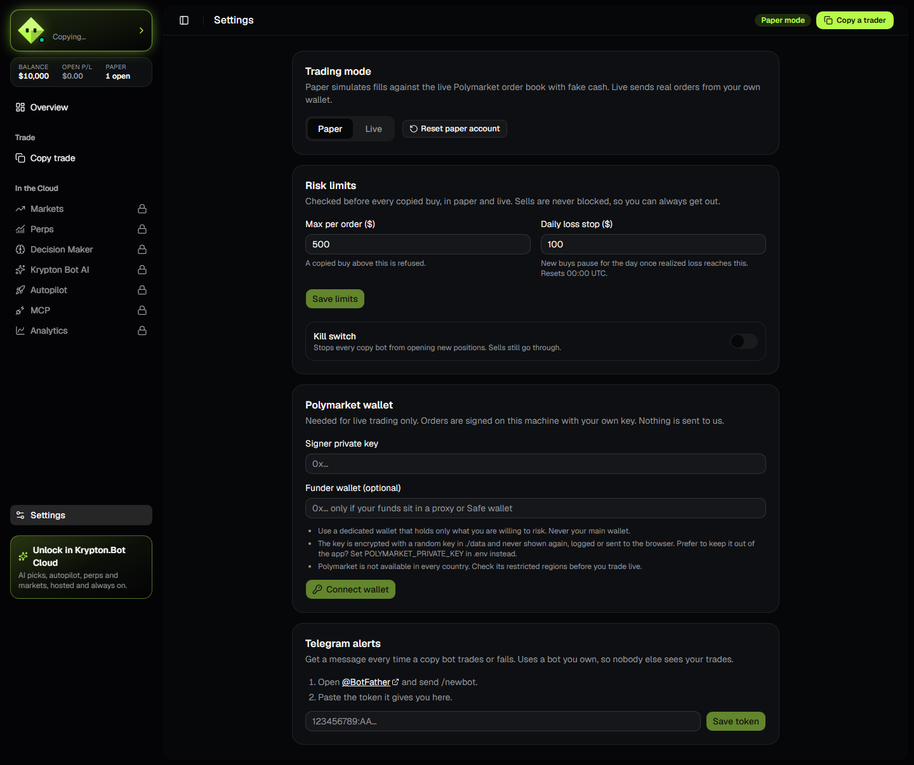

<p align="center">
  
</p>

<p align="center">
  <a href="LICENSE"></a>
  
  
  
</p>

# Krypton Bot Light

**Pick a proven Polymarket trader. Your bot mirrors every buy and sell within a second.** Start in paper mode with fake cash, go live with your own wallet when you trust it. It runs on your machine, keeps its data in one folder, and needs no account, no database server and no API keys.

This is the free, open-source edition of [Krypton.Bot](https://krypton.bot), cut down to do one thing well: copy trading.

> ### Want the full AI trading bot? Try [Krypton.Bot Cloud](https://krypton.bot)
>
> Everything in Light, plus:
>
> - **Krypton Bot AI agent.** Ask in plain words. It researches news, X, order books and smart money, then trades for you.
> - **Autopilot and Decision Maker.** It runs 24/7, scores every call 24 hours later and learns from the results.
> - **AI trader picks.** A copy score for every trader, and a size fitted to your balance.
> - **Prediction markets and perps**, not just copy trading.
> - **Always on.** It keeps copying while your laptop is closed. Nothing to install.
> - **MCP server and analytics.** Connect Claude or Cursor, and track your P/L, win rate and bot accuracy.
>
> **[Start free in paper mode at krypton.bot](https://krypton.bot/register)**. No card needed. Upgrade to Pro for live trading and the AI.

## Quick start

```bash
git clone https://github.com/krypton-bot/krypton-bot.git && cd krypton-bot
npm install
npm run dev
```

Open <http://localhost:3000>. It lands straight on the dashboard. Pick a trader on **Copy trade**, press **Copy**, done. You need Node.js 24 or newer.

Prefer Docker? `docker compose up --build`, then open <http://localhost:3000>. The data lives in a volume.

## What you get

- **Copy trading, complete.** Live feed of every Polymarket trade, the profit leaderboard (day, week, month, all time), this week's hot traders with a cautious starter size, and a stats panel before you commit: P/L per window, win rate over the last 100 closed positions, trades per day, median trade size, favourite markets.
- **Copy bots you control.** Size as a percentage of the leader's trade, a hard dollar cap per trade, a 3 cent slippage guard, pause, resume or remove at any time, up to 20 traders at once.
- **Paper mode.** Fills are simulated against the live Polymarket order book with $10,000 of fake cash. Open P/L is marked at the live midpoint.
- **Live mode.** Fill-and-kill market orders from your own wallet through the official Polymarket SDK. The key stays on your machine.
- **Risk limits that really apply.** Per-order cap, daily loss stop, and a kill switch. Checked before every copied buy, in paper and live. Sells are never blocked, so you can always get out.
- **Telegram alerts.** A message for each copied trade or failure, from a bot you create yourself with @BotFather.
- **The Krypton look.** Same sidebar, bot dock, cards, colours and fonts as the cloud app.
- **Zero services.** Data sits in an embedded Postgres ([PGlite](https://pglite.dev), WASM) in `./data`. No Docker, no Postgres, no Redis. Bound to `127.0.0.1` by default.

## Screenshots

Taken from the running app with Playwright (`node scripts/screenshots.cjs`).

| Overview | Copy picks and leaderboard |
| --- | --- |
|  |  |

| Trader stats before you copy | A copy bot running in paper mode |
| --- | --- |
|  |  |

| The bot dock | Locked cloud features |
| --- | --- |
|  |  |

| Settings |
| --- |
|  |

## How copying works

1. The server holds one connection to Polymarket's real-time trade feed (about 50 trades a second).
2. When a wallet you copy trades, your bot sees it within milliseconds. Detection and execution times are stored with each trade.
3. A **buy** is sized at *your %* of the leader's dollars, capped at your *max per trade*, and skipped below $1. A **sell** closes the same *%* of their shares. Prices are capped at the leader's price plus 3 cents, so you never chase.
4. Your risk limits are checked, then the order fills against the live order book (paper) or goes out from your wallet (live).
5. Every trade is deduplicated by transaction, so a repeated feed message never double-copies.

Good to know: bots copy only while the app is running. Trades made while it was off are **not** back-filled, because copying a stale fill is worse than missing it.

## Going live

1. Create a **dedicated** wallet and fund it with only what you are willing to lose.
2. In **Settings > Polymarket wallet**, paste the signer private key (and the funder address if your funds sit in a proxy or Safe wallet). Or set `POLYMARKET_PRIVATE_KEY` in `.env` and nothing is stored at all.
3. Flip **Trading mode** to **Live** and confirm. Set the risk limits first.

The live path uses the official `@polymarket/client` SDK with your own credentials. It has been exercised against paper fills and the public APIs, but not with a funded wallet in CI, so **start with a tiny amount** and watch the first few trades.

> **Check Polymarket's restricted regions before you trade live.** Polymarket is not available everywhere, and some jurisdictions are blocked from placing orders. Following its rules is your responsibility. Paper mode and the public data work from anywhere.

## Light vs Cloud

| | Light (this repo) | Cloud |
| --- | :---: | :---: |
| Copy trading: leaderboard, trader stats, live feed | yes | yes |
| Paper and live trading with your own wallet | yes | yes |
| Risk limits, kill switch, Telegram alerts | yes | yes |
| Runs on your machine, data stays local | yes | |
| Always on, keeps copying when your laptop is closed | | yes |
| AI-researched trader picks, Krypton Bot AI agent | | yes |
| Autopilot and Decision Maker | | yes |
| Prediction markets and perps trading | | yes |
| MCP server and analytics | | yes |

Light is MIT licensed and stays free and fully working on its own. If you would rather not run it yourself, or you want the AI agent and autopilot, that is [Krypton.Bot Cloud](https://krypton.bot).

## Security

- **No secrets in the repo.** Only `.env.example`. `.env` and `./data` are git-ignored.
- **Your key never leaves your machine.** It is encrypted with AES-256-GCM using a random key in `./data/.secret` (or your own `CREDENTIALS_KEY`), never returned by any API, never logged, never sent to a third party. The browser only ever sees addresses.
- **Local only by default.** The dev and start scripts bind to `127.0.0.1`. The API also rejects any request whose `Host` is not localhost (blocks DNS-rebinding) and any cross-site write (blocks CSRF). Every API route validates its input with zod.
- **There is no login.** That is the point of a local app, and also why you must not expose it to the internet. If you run it on a server, put your own authenticated reverse proxy in front and list the hostname in `ALLOWED_HOSTS`.
- One process owns `./data` at a time. A second copy refuses to start instead of corrupting the database.
- No analytics, no telemetry, no builder or referral fees. The only network calls are to Polymarket (and Telegram if you enable it). The locked menu items are plain links to krypton.bot and send nothing.

## FAQ

**Do I need an account or API key?** No. Paper mode needs nothing at all. Live mode needs your own wallet key. Telegram needs your own bot token.

**Where is my data?** In `./data` (override with `DATA_DIR`). Copy the folder to back it up, delete it to start fresh. **Settings > Reset paper account** resets just the paper cash, positions and activity feed.

**Why does it stop copying when I close it?** It is a local app: the engine lives in the server process. Run it on something that stays on (a spare PC, a Raspberry Pi, a VPS with the localhost warning above in mind) or use Docker with `restart: unless-stopped`.

**How realistic is paper mode?** Fills walk the live order book, so size and slippage are honest for the moment you copy. It does not model fees, queue priority or your trade moving the price.

**Does it charge fees?** No. Light adds no fee and no builder code. Polymarket's own rules apply to live orders.

**Can I copy more than Polymarket traders?** Not in Light. Copying wallets on Polymarket is what it does.

**Windows, macOS, Linux?** All three, on Node 24 or newer, or any machine with Docker.

## Develop

```bash
npm run dev         # dev server on 127.0.0.1:3000
npm run typecheck   # tsc --noEmit
npm run lint
npm run build && npm start
node scripts/screenshots.cjs   # end-to-end check + screenshots (needs the `playwright` package)
```

Layout: `src/lib/copy` (engine), `src/lib/trading` (paper fills, live orders, risk limits), `src/lib/polymarket` (public clients and the live trade feed), `src/db` (schema and embedded Postgres), `src/app/api` (validated local routes), `src/components` (UI). Schema migrations are in `drizzle/`; after editing `src/db/schema.ts` run `npm run db:generate`.

## Disclaimer

**Not financial advice. Trading involves risk of loss.** Past performance of any trader says nothing about the future, and copying someone does not make you as good as them. Software is provided as is, without warranty. You are responsible for your own funds, your keys and for complying with the laws and the platform rules where you live.

## License

[MIT](LICENSE)
